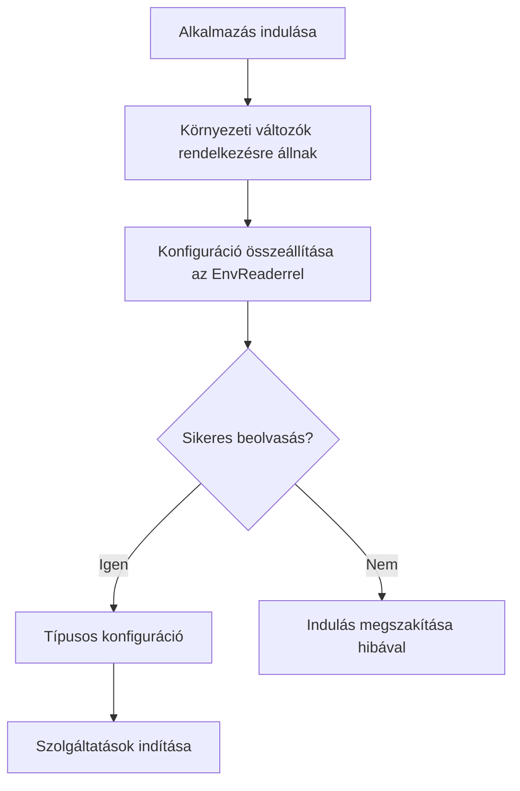

# Első lépések

## Telepítés

```sh
npm install @atom-forge/env-reader
```

A publikus belépési pontból importáld az `EnvReader` osztályt és szükség esetén az `asReadonly` függvényt.

```typescript
import { EnvReader, asReadonly } from "@atom-forge/env-reader";

const env = new EnvReader(process.cwd());

export const config = asReadonly({
    mode: env.oneOf("APP_ENV", ["dev", "prod", "test"], "prod"),
    databaseUrl: env.string("DATABASE_URL"),
    port: env.int("PORT", 3000),
});
```

A `process.cwd()` abszolút útvonal, de a folyamat munkakönyvtárát jelenti. Csak akkor használd projektgyökérként, ha az alkalmazást valóban onnan indítod; más esetben adj át explicit abszolút projektútvonalat.

## Az indulás menete



> [!warning] A környezet betöltése a te feladatod
> Az `EnvReader` nem olvas `.env` fájlt. Ha ilyen fájlból töltöd a környezetet, ezt a konfiguráció összeállítása előtt végezd el a futtatókörnyezet vagy egy külön betöltő segítségével.

## Kötelező érték vagy default?

Ha egy változó `undefined`, default nélkül a metódus hibát dob. A default általában csak a hiányzó változót helyettesíti: egy jelen lévő, de hibás értéket nem javít ki.

```typescript
const required = env.string("DATABASE_URL");
const optional = env.boolean("DEBUG", false);
```

> [!note] Üres nem egyenlő hiányzóval
> A `KEY=""` jelen lévő változó. A `string()` üres szöveget adhat vissza, a `list()` üres listát; más metódusok hibát dobhatnak. Ha nem üres szöveget vársz, ezt külön ellenőrizd.

A következő fejezet: [[02-values|Értékek és listák]].
