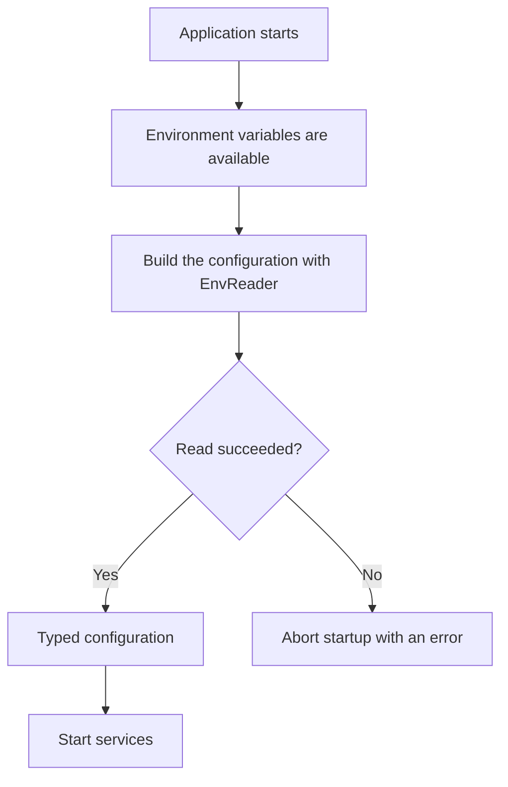

# Getting Started

## Installation

```sh
npm install @atom-forge/env-reader
```

Import the `EnvReader` class and, when needed, the `asReadonly` function from the public entry point.

```typescript
import { EnvReader, asReadonly } from "@atom-forge/env-reader";

const env = new EnvReader(process.cwd());

export const config = asReadonly({
    mode: env.oneOf("APP_ENV", ["dev", "prod", "test"], "prod"),
    databaseUrl: env.string("DATABASE_URL"),
    port: env.int("PORT", 3000),
});
```

`process.cwd()` is an absolute path, but it means the working directory of the process. Use it as the project root only if you really start the application from there; otherwise pass an explicit absolute project path.

## How startup works



> [!warning] Loading the environment is your job
> `EnvReader` does not read `.env` files. If you load the environment from such a file, do it before building the configuration, using the runtime or a separate loader.

## Required value or default?

If a variable is `undefined` and no default is given, the method throws. A default normally replaces only a missing variable: it does not repair a value that is present but invalid.

```typescript
const required = env.string("DATABASE_URL");
const optional = env.boolean("DEBUG", false);
```

> [!note] Empty is not the same as missing
> `KEY=""` is a present variable. `string()` may return an empty string and `list()` an empty list; other methods may throw. If you expect a non-empty string, check it separately.

Next chapter: [[02-values|Values and Lists]].
