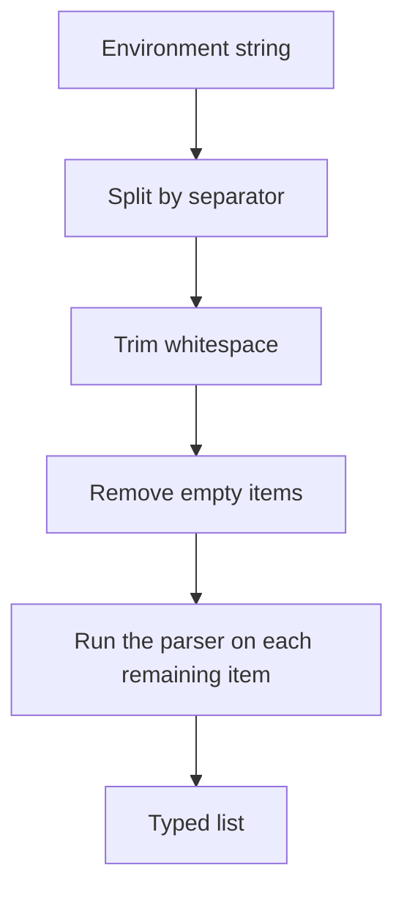

# Values and Lists

## Method overview

| Call | Result | Behavior |
|---|---|---|
| `string(key, defaultValue?, trim = true)` | `string` | Trims surrounding whitespace by default. |
| `int(key, defaultValue?, radix = 10)` | `number` | Based on `parseInt`. |
| `float(key, defaultValue?)` | `number` | Based on `parseFloat`. |
| `boolean(key, defaultValue?)` | `boolean` | `true/false`, `yes/no`, `1/0`; case-insensitive. |
| `oneOf(key, values, defaultValue?)` | allowed string type | After trimming, looks for an exact, case-sensitive match. |
| `regex(key, defaultValue?)` | `RegExp` | After trimming, uses the `new RegExp` constructor. |
| `list(key, parser, defaultValue?, separator = ",")` | `T[]` | Split, trim, drop empty items, parse. |

```typescript
const name = env.string("APP_NAME", "My app");
const raw = env.string("RAW_TEXT", undefined, false);
const port = env.int("PORT", 3000);
const ratio = env.float("SAMPLING_RATIO", 0.5);
const debug = env.boolean("DEBUG", false);
const mode = env.oneOf("APP_ENV", ["dev", "prod", "test"], "prod");
const pattern = env.regex("NAME_PATTERN", /^[a-z]+$/i);
```

> [!warning] The number parsers are not strict validators
> `int()` and `float()` reject only a `NaN` result. For example, `int()` reads `"12px"` as `12`, and `float()` may accept `Infinity`. Check ranges, finiteness, or a full-string match separately.

> [!note] Defaults
> String, number, boolean, oneOf, regex, and list defaults are returned directly, without being parsed again. Provide trusted, pre-validated values.

## Lists

```typescript
// ALLOWED_HOSTS= example.com, api.example.com, ,
const hosts = env.list("ALLOWED_HOSTS", value => value);
// ["example.com", "api.example.com"]

const labels = env.list("LABELS", value => value, [], ";");
```



The parser must throw when it finds an invalid item. The library does not automatically treat a returned `NaN` as an error.

```typescript
const ports = env.list("ALLOWED_PORTS", value => {
    if (!/^\d+$/.test(value)) throw new Error("Expected decimal digits");
    const port = Number(value);
    if (!Number.isSafeInteger(port) || port < 1 || port > 65535) {
        throw new Error("Port out of range");
    }
    return port;
});
```

> [!info] Invalid list item
> A parser error becomes an `Env variable type failed: KEY[index] - value` error. The index is zero-based and counted after empty items are removed; the original parser error message is not preserved.

## Regular expressions

The environment value is the pattern itself, not a JavaScript regex literal. `^[a-z]+$` is correct; the text `/^[a-z]+$/i` does not enable the `i` flag. There is no separate flags parameter for patterns read from the environment; a default `RegExp` object may have flags.

Continue with [[03-urls|URLs and Mappings]].
