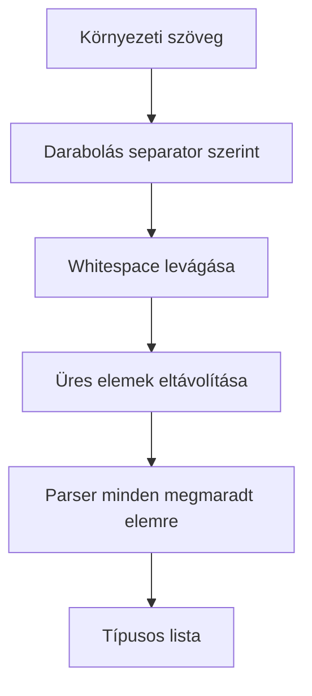

# Értékek és listák

## Metódusok áttekintése

| Hívás | Eredmény | Viselkedés |
|---|---|---|
| `string(key, defaultValue?, trim = true)` | `string` | Alapból levágja a szélső whitespace-t. |
| `int(key, defaultValue?, radix = 10)` | `number` | `parseInt` alapú feldolgozás. |
| `float(key, defaultValue?)` | `number` | `parseFloat` alapú feldolgozás. |
| `boolean(key, defaultValue?)` | `boolean` | `true/false`, `yes/no`, `1/0`; nem kis- és nagybetűérzékeny. |
| `oneOf(key, values, defaultValue?)` | megengedett stringtípus | Trim után pontos, kis- és nagybetűérzékeny egyezést keres. |
| `regex(key, defaultValue?)` | `RegExp` | Trim után `new RegExp` konstruktorral dolgozik. |
| `list(key, parser, defaultValue?, separator = ",")` | `T[]` | Darabolás, trim, üres elemek szűrése, parser. |

```typescript
const name = env.string("APP_NAME", "My app");
const raw = env.string("RAW_TEXT", undefined, false);
const port = env.int("PORT", 3000);
const ratio = env.float("SAMPLING_RATIO", 0.5);
const debug = env.boolean("DEBUG", false);
const mode = env.oneOf("APP_ENV", ["dev", "prod", "test"], "prod");
const pattern = env.regex("NAME_PATTERN", /^[a-z]+$/i);
```

> [!warning] A számparser nem szigorú validátor
> Az `int()` és `float()` csak a `NaN` eredményt utasítja el. Például az `int()` a `"12px"` értéket `12`-ként olvassa, a `float()` pedig elfogadhatja az `Infinity` értéket. Tartományt, véges értéket vagy teljes szöveges egyezést külön ellenőrizz.

> [!note] Defaultok
> A string-, szám-, boolean-, oneOf-, regex- és list-defaultok közvetlenül kerülnek visszaadásra, újrafeldolgozás nélkül. Megbízható, előre ellenőrzött értékeket adj meg.

## Listák

```typescript
// ALLOWED_HOSTS= example.com, api.example.com, ,
const hosts = env.list("ALLOWED_HOSTS", value => value);
// ["example.com", "api.example.com"]

const labels = env.list("LABELS", value => value, [], ";");
```



A parsernek dobnia kell, ha hibás elemet észlel. A könyvtár nem tekinti automatikusan hibának a visszaadott `NaN` értéket.

```typescript
const ports = env.list("ALLOWED_PORTS", value => {
    if (!/^\d+$/.test(value)) throw new Error("Expected decimal digits");
    const port = Number(value);
    if (!Number.isSafeInteger(port) || port < 1 || port > 65535) {
        throw new Error("Port out of range");
    }
    return port;
});
```

> [!info] Hibás listaelem
> A parser hibája `Env variable type failed: KEY[index] - value` hibává alakul. Az index az üres elemek kiszűrése utáni, nullától induló index; az eredeti parserhiba üzenete nem marad meg.

## Reguláris kifejezések

A környezeti érték maga a minta, nem JavaScript regexliterál. A `^[a-z]+$` megfelelő; a `/^[a-z]+$/i` szöveg nem kapcsolja be az `i` flaget. A környezetből olvasott mintákhoz nincs külön flags-paraméter; egy default `RegExp` objektumnak lehetnek flagjei.

Tovább: [[03-urls|URL-ek és leképezések]].
