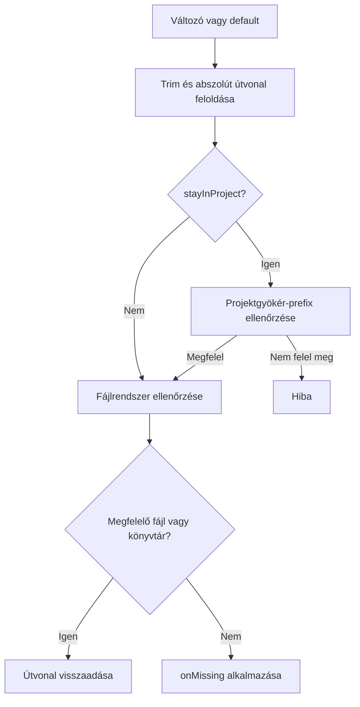

# Fájlok és könyvtárak

```typescript
const certificate = env.file("TLS_CERT", "certs/server.pem");
const uploads = env.dir("UPLOAD_DIR", "var/uploads");
```

Mindkét metódus abszolút útvonalat ad vissza, és szinkron fájlrendszer-ellenőrzést végez.

```typescript
file(key, defaultValue?, onMissing = true, stayInProject = true)
dir(key, defaultValue?, onMissing = true, stayInProject = true)
```

## Feloldási módok

- `stayInProject = true`: `path.resolve(projectRoot, value.trim())` szerint oldja fel az értéket, majd ellenőrzi az útvonalprefixet.
- `stayInProject = false`: `path.resolve(value.trim())` szerint oldja fel; relatív értéknél a folyamat munkakönyvtára számít, nem a megadott projektgyökér.



## Hiányzó vagy rossz típusú útvonal

| `onMissing` | Viselkedés |
|---|---|
| `true` | Hibát dob; ez az alapértelmezés. |
| `false` | Visszaadja az útvonalat, létrehozás nélkül. |
| `(path) => void` | Meghívja a callbacket, majd visszaadja az útvonalat, ha a callback nem dobott. |

A callback hiányzó útvonalnál és rossz típusnál is futhat: például ha a `dir()` által vizsgált helyen fájl található. A callback után nincs újabb típusellenőrzés.

```typescript
import * as fs from "node:fs";

const cache = env.dir("CACHE_DIR", "var/cache", directory => {
    fs.mkdirSync(directory, { recursive: true });
});
```

> [!note] Hiányzó változó továbbra is hiba
> Az `onMissing = false` csak a fájlrendszerbeli ellenőrzés eredményét kezeli. Ha a környezeti változó és a default is hiányzik, a metódus hibát dob.

> [!danger] Nem biztonsági sandbox
> A jelenlegi projektkorlát egyszerű `startsWith(projectRoot)` ellenőrzés, nem szegmenshatár- és nem realpath-alapú. Egy hasonló prefixű testvérkönyvtár vagy egy symlink kívülre mutathat. Ne használd nem megbízható bemenetek biztonsági elszigetelésére; ilyen esetben külön kanonikus útvonal- és határellenőrzés szükséges.

Tovább: [[05-integration|Integráció és hibakezelés]].
