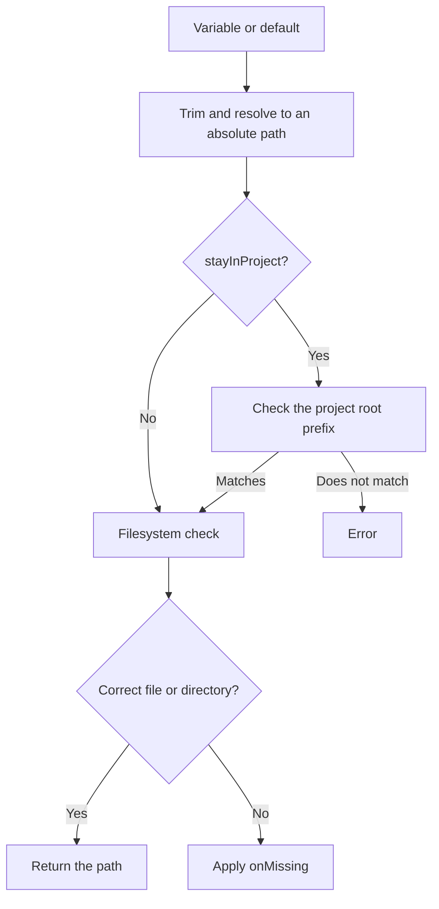

# Files and Directories

```typescript
const certificate = env.file("TLS_CERT", "certs/server.pem");
const uploads = env.dir("UPLOAD_DIR", "var/uploads");
```

Both methods return an absolute path and perform a synchronous filesystem check.

```typescript
file(key, defaultValue?, onMissing = true, stayInProject = true)
dir(key, defaultValue?, onMissing = true, stayInProject = true)
```

## Resolution modes

- `stayInProject = true`: resolves the value with `path.resolve(projectRoot, value.trim())`, then checks the path prefix.
- `stayInProject = false`: resolves the value with `path.resolve(value.trim())`; for a relative value, the working directory of the process counts, not the given project root.



## Missing or wrong-type paths

| `onMissing` | Behavior |
|---|---|
| `true` | Throws an error; this is the default. |
| `false` | Returns the path without creating anything. |
| `(path) => void` | Calls the callback, then returns the path if the callback did not throw. |

The callback may run both for a missing path and for a wrong type: for example, when a file is found where `dir()` is looking. There is no further type check after the callback.

```typescript
import * as fs from "node:fs";

const cache = env.dir("CACHE_DIR", "var/cache", directory => {
    fs.mkdirSync(directory, { recursive: true });
});
```

> [!note] A missing variable is still an error
> `onMissing = false` only handles the result of the filesystem check. If both the environment variable and the default are missing, the method throws.

> [!danger] Not a security sandbox
> The current project boundary is a plain `startsWith(projectRoot)` check, based neither on segment boundaries nor on realpath. A sibling directory with a similar prefix, or a symlink, may point outside. Do not use it as security isolation for untrusted input; that needs a separate canonical path and boundary check.

Continue with [[05-integration|Integration and Error Handling]].
