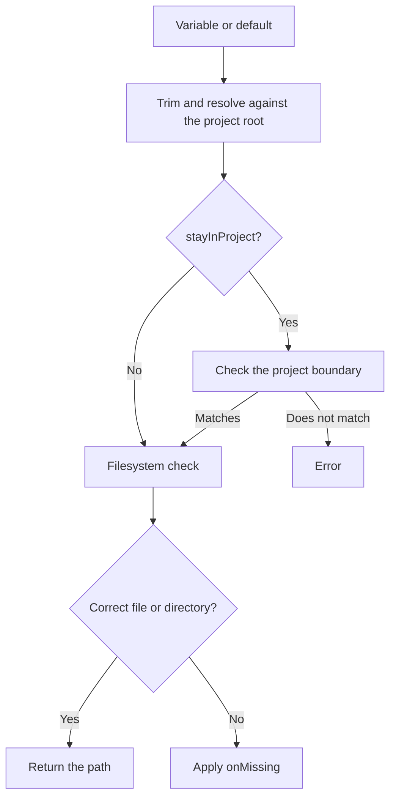

# Files and Directories

```typescript
const certificate = env.file("TLS_CERT", "certs/server.pem");
const uploads = env.dir("UPLOAD_DIR", "var/uploads");
```

Both methods return an absolute path and perform a synchronous filesystem check.

```typescript
file(key, defaultValue?, onMissing = true, stayInProject = true)
dir(key, defaultValue?, onMissing = true, stayInProject = true)
```

## Resolution

The value is trimmed and resolved with `path.resolve(projectRoot, value)`, regardless of `stayInProject`: a relative path always counts from the project root, an absolute path stays as it is. An empty value throws. The project root itself is normalized with `path.resolve` in the constructor.

- `stayInProject = true`: the resolved path must lie inside the project root, both lexically and after resolving symlinks.
- `stayInProject = false`: no boundary check; external absolute or `../` paths are allowed.



## Missing or wrong-type paths

| `onMissing` | Behavior |
|---|---|
| `true` | Throws an error; this is the default. |
| `false` | Returns the path without creating anything. |
| `(path) => void` | Calls the callback, then returns the path if the callback did not throw. |

The callback may run both for a missing path and for a wrong type: for example, when a file is found where `dir()` is looking. There is no further type check after the callback.

```typescript
import * as fs from "node:fs";

const cache = env.dir("CACHE_DIR", "var/cache", directory => {
    fs.mkdirSync(directory, { recursive: true });
});
```

> [!note] A missing variable is still an error
> `onMissing = false` only handles the result of the filesystem check. If both the environment variable and the default are missing, the method throws.

> [!warning] A startup check, not a sandbox
> The project boundary is compared by path segments, so a sibling such as `/app-evil` is not inside `/app`. Symlinks are resolved too, including those in the parent of a path that does not exist yet. The check runs once, when the method is called: if the filesystem changes later (for example a directory is replaced by a symlink), the returned path is not re-validated. Do not treat it as isolation for untrusted input that is opened much later.

Continue with [[integration|Integration and Error Handling]].
