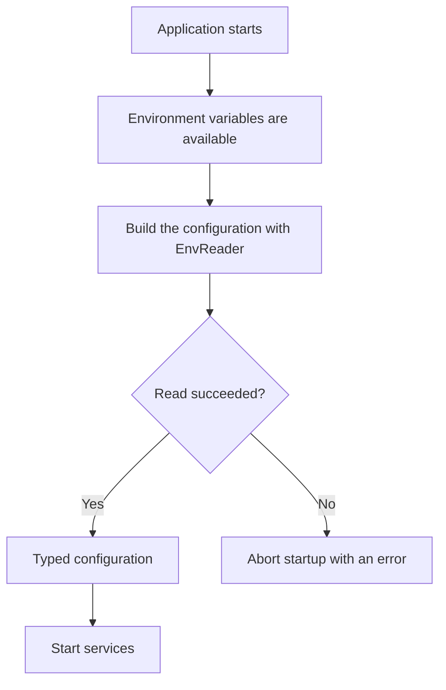
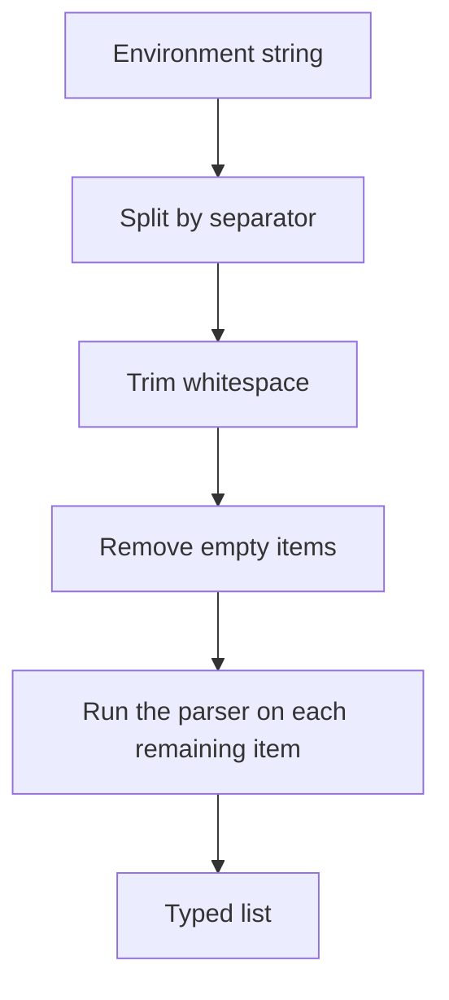
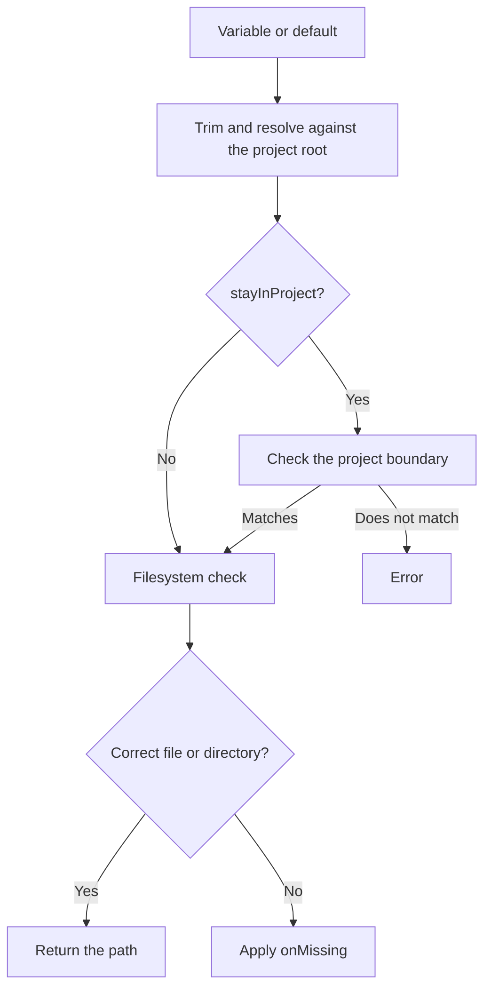

# @atom-forge/env-reader

> This page is the single-page version of the [Env Reader book](https://books.atom-forge.eu). Magyar változat: [docs/hu/index.md](../hu/index.md).

This guide shows how to read environment configuration in TypeScript applications: from installation to a typed configuration object, from URL mapping to filesystem paths.

`EnvReader` reads the current values of `process.env` with synchronous methods. Errors surface when you call those methods, so to validate at startup you must build the configuration when the application starts.

This guide is for developers of Node-compatible TypeScript applications (Node.js, Bun, Deno with Node compatibility) who want their configuration typed and validated in one place.

> **Tip: Recommended reading order**
>
> Start with the [Getting Started](#getting-started) section, then read the data types you need. [Integration and Error Handling](#integration-and-error-handling) gives a complete configuration example. Upgrading from an earlier version? Read [Upgrading](#upgrading). Working with a coding agent? Point it to [README-AI.md](../../README-AI.md).

## What you get

- Required and default configuration values.
- Parsing of strings, numbers, booleans, lists, and regular expressions.
- URL objects and typed URL component mapping.
- Resolution of file and directory paths.
- Deeply readonly TypeScript types through `asReadonly`.

> **Note: Runtime environment**
>
> The package uses `process.env` and the Node-compatible `fs` and `path` modules. It is not a browser-side configuration library and not a `.env` loader.

## Getting Started

### Installation

```sh
npm install @atom-forge/env-reader
```

Import the `EnvReader` class and, when needed, the `asReadonly` function from the public entry point.

```typescript
import { EnvReader, asReadonly } from "@atom-forge/env-reader";

const env = new EnvReader(process.cwd());

export const config = asReadonly({
    mode: env.oneOf("APP_ENV", ["dev", "prod", "test"], "prod"),
    databaseUrl: env.string("DATABASE_URL"),
    port: env.int("PORT", 3000),
});
```

`process.cwd()` is an absolute path, but it means the working directory of the process. Use it as the project root only if you really start the application from there; otherwise pass an explicit absolute project path.

### How startup works



> **Warning: Loading the environment is your job**
>
> `EnvReader` does not read `.env` files. If you load the environment from such a file, do it before building the configuration, using the runtime or a separate loader.

### Required value or default?

If a variable is `undefined` and no default is given, the method throws. A default normally replaces only a missing variable: it does not repair a value that is present but invalid.

```typescript
const required = env.string("DATABASE_URL");
const optional = env.boolean("DEBUG", false);
```

> **Note: Empty is not the same as missing**
>
> `KEY=""` is a present variable, so the default does not apply. `string()` returns an empty string and `list()` an empty list; every other method throws. If you expect a non-empty string, check it separately.

## Values and Lists

### Method overview

| Call | Result | Behavior |
|---|---|---|
| `string(key, defaultValue?, trim = true)` | `string` | Trims surrounding whitespace by default. |
| `int(key, defaultValue?, radix = 10)` | `number` | The whole value must be an integer in the given radix (2–36); a `0x` prefix is allowed for radix 16. |
| `float(key, defaultValue?)` | `number` | The whole value must be a finite decimal number, optionally with an exponent. |
| `boolean(key, defaultValue?)` | `boolean` | `true/false`, `yes/no`, `1/0`; case-insensitive. |
| `oneOf(key, values, defaultValue?)` | allowed string type | After trimming, looks for an exact, case-sensitive match. `values` may be an `as const` array. |
| `regex(key, defaultValue?)` | `RegExp` | After trimming, uses the `new RegExp` constructor; an empty pattern is rejected. |
| `list(key, parser, defaultValue?, separator = ",")` | `T[]` | Split, trim, drop empty items, parse. |

```typescript
const name = env.string("APP_NAME", "My app");
const raw = env.string("RAW_TEXT", undefined, false);
const port = env.int("PORT", 3000);
const ratio = env.float("SAMPLING_RATIO", 0.5);
const debug = env.boolean("DEBUG", false);
const mode = env.oneOf("APP_ENV", ["dev", "prod", "test"], "prod");
const pattern = env.regex("NAME_PATTERN", /^[a-z]+$/i);
```

> **Warning: Number parsers check the format, not the range**
>
> `int()` and `float()` reject partial matches such as `"12px"` or `"1.5"` (for `int()`), as well as `Infinity`, `NaN`, hexadecimal floats, and integers beyond `Number.MAX_SAFE_INTEGER`. Minimums, maximums, and other domain ranges are still your job.

> **Note: Defaults**
>
> String, number, boolean, oneOf, regex, and list defaults are returned directly, without being parsed again. Provide trusted, pre-validated values.

### Lists

```typescript
// ALLOWED_HOSTS= example.com, api.example.com, ,
const hosts = env.list("ALLOWED_HOSTS", value => value);
// ["example.com", "api.example.com"]

const labels = env.list("LABELS", value => value, [], ";");
```



The parser must throw when it finds an invalid item. The library does not automatically treat a returned `NaN` as an error.

```typescript
const ports = env.list("ALLOWED_PORTS", value => {
    if (!/^\d+$/.test(value)) throw new Error("Expected decimal digits");
    const port = Number(value);
    if (!Number.isSafeInteger(port) || port < 1 || port > 65535) {
        throw new Error("Port out of range");
    }
    return port;
});
```

> **Info: Invalid list item**
>
> A parser error becomes an `Env variable type failed: KEY[index] - value` error. The index is zero-based and counted after empty items are removed; the original parser error message is not preserved.

### Regular expressions

The environment value is the pattern itself, not a JavaScript regex literal. `^[a-z]+$` is correct; the text `/^[a-z]+$/i` does not enable the `i` flag. There is no separate flags parameter for patterns read from the environment; a default `RegExp` object may have flags. An empty (or whitespace-only) value throws instead of producing a pattern that matches everything.

## URLs and Mappings

### The URL object

```typescript
const api = env.url("API_URL", "https://api.example.com/v1/");
console.log(api.hostname); // The hostname of the configured URL
```

The return value is a standard `URL` object. The environment string is trimmed before it is passed to the constructor. The default URL is also parsed and validated; to avoid leaking credentials, the error message does not repeat the invalid default.

> **Warning: A valid URL is not necessarily an allowed URL**
>
> The method does not restrict the protocol to HTTPS and does not apply a host allowlist. If your use case needs that, check the `protocol` and `hostname` fields separately.

### Typed component mapping

```typescript
// S3_URL=s3://accessKey:secretKey@storage.example.com/assets/files/
const storage = env.url("S3_URL", {
    map: {
        accessKey: "username",
        secretKey: "password",
        host: "hostname",
        bucket: "path(0)",
        prefix: ["path(1,end)", ""],
    },
});
// bucket: "assets", prefix: "files/"; every field is a string
```

The second argument is the options object: `map` and an optional `defaultValue`. The output keys match the keys of the map; every value is a string.

| Selector | Meaning |
|---|---|
| `protocol` | Protocol with a colon, for example `https:`. |
| `username`, `password` | Percent-decoded credential components. |
| `hostname` | Hostname without the port. |
| `host` | Hostname with the port, if the URL object keeps one. |
| `port` | Port as a string; may be empty. |
| `origin` | String assembled as `${protocol}//${host}`. |
| `path` | Decoded pathname without the leading `/`. |
| `hash` | Fragment including the `#`, when present. |
| `path(index)` | One decoded path segment. |
| `path(start,end)` | Inclusive segment range; the end index may be `end`. |
| `query("name")` | Value of the first query parameter with that name; single quotes also work. |

The URL constructor may normalize values, for example by removing a default port. Here `origin` is assembled by the package itself, not taken directly from the `URL.origin` property.

### Path segments

Indexing is zero-based; a negative index counts from the end. Indexed selectors drop empty segments during the split.

For the path `/assets/images/logo.svg`:

- `path(0)` → `assets`
- `path(-1)` → `logo.svg`
- `path(1,end)` → `images/logo.svg`

When a range reaches the last segment, it keeps the URL's trailing `/` if there was one. Selecting a single segment does not add it.

### Fallbacks, precisely

```typescript
const endpoint = env.url("SERVICE_URL", {
    defaultValue: "https://api.example.com/v1/",
    map: {
        host: "hostname",
        token: ['query("token")', ""],
        extraPath: ["path(2,end)", ""],
    },
});
```

> **Warning: Not every empty component triggers a fallback**
>
> A fallback applies only to a missing query parameter and to a path segment out of range. A missing `username`, `password`, `port`, or `hash` comes back as an empty string even without a fallback. `?token=` also yields an empty string, not the default.

An invalid selector or malformed percent-encoding is not swallowed by the fallback. Mapping errors are prefixed with `Env variable URL map failed: KEY - ...`; a malformed escape is reported as `Malformed percent-encoding in URL component: <selector>`, without the raw value.

## Files and Directories

```typescript
const certificate = env.file("TLS_CERT", "certs/server.pem");
const uploads = env.dir("UPLOAD_DIR", "var/uploads");
```

Both methods return an absolute path and perform a synchronous filesystem check.

```typescript
file(key, defaultValue?, onMissing = true, stayInProject = true)
dir(key, defaultValue?, onMissing = true, stayInProject = true)
```

### Resolution

The value is trimmed and resolved with `path.resolve(projectRoot, value)`, regardless of `stayInProject`: a relative path always counts from the project root, an absolute path stays as it is. An empty value throws. The project root itself is normalized with `path.resolve` in the constructor.

- `stayInProject = true`: the resolved path must lie inside the project root, both lexically and after resolving symlinks.
- `stayInProject = false`: no boundary check; external absolute or `../` paths are allowed.



### Missing or wrong-type paths

| `onMissing` | Behavior |
|---|---|
| `true` | Throws an error; this is the default. |
| `false` | Returns the path without creating anything. |
| `(path) => void` | Calls the callback, then returns the path if the callback did not throw. |

The callback may run both for a missing path and for a wrong type: for example, when a file is found where `dir()` is looking. There is no further type check after the callback.

```typescript
import * as fs from "node:fs";

const cache = env.dir("CACHE_DIR", "var/cache", directory => {
    fs.mkdirSync(directory, { recursive: true });
});
```

> **Note: A missing variable is still an error**
>
> `onMissing = false` only handles the result of the filesystem check. If both the environment variable and the default are missing, the method throws.

> **Warning: A startup check, not a sandbox**
>
> The project boundary is compared by path segments, so a sibling such as `/app-evil` is not inside `/app`. Symlinks are resolved too, including those in the parent of a path that does not exist yet. The check runs once, when the method is called: if the filesystem changes later (for example a directory is replaced by a symlink), the returned path is not re-validated. Do not treat it as isolation for untrusted input that is opened much later.

## Integration and Error Handling

### A single configuration module

The rest of the application should use a pre-built configuration instead of repeating environment reads.

```text
src/
  config.ts       # Read and validate environment values
  server.ts       # Use the configuration
```

```typescript
// config.ts
import { EnvReader, asReadonly } from "@atom-forge/env-reader";

const env = new EnvReader(process.cwd());
const port = env.int("PORT", 3000);
if (!Number.isInteger(port) || port < 1 || port > 65535) {
    throw new Error("PORT must be an integer between 1 and 65535");
}

export const config = asReadonly({
    app: {
        mode: env.oneOf("APP_ENV", ["dev", "prod", "test"], "prod"),
        port,
        debug: env.boolean("DEBUG", false),
    },
    database: {
        url: env.url("DATABASE_URL"),
        poolSize: env.int("DB_POOL_MAX", 20),
    },
    auth: {
        secret: env.string("JWT_SECRET"),
    },
});

if (!config.auth.secret) {
    throw new Error("JWT_SECRET must not be empty");
}
```

> **Tip: You define the domain rules**
>
> The minimum pool size, the minimum secret length, the allowed URL protocol, and relationships between fields need separate application-level checks. The library is not a configuration schema or a business validator.

### What does asReadonly mean?

```typescript
const config = asReadonly({ db: { host: "localhost" } });
// config.db.host = "other"; // TypeScript compile error
```

`asReadonly<T>(value: T): DeepReadonly<T>` returns the same object, using a type assertion. It makes no copy and does not call `Object.freeze`. Functions, `URL`, `RegExp`, `Date`, and `Error` values keep their own types, so they stay callable and usable; arrays, maps, and sets become their readonly variants.

> **Warning: Type-level protection only**
>
> From JavaScript, or through another mutable reference, the object can still be modified. A readonly type is not runtime immutability or a security boundary.

### Error handling and logging

The methods throw synchronous `Error`s. There is no error report that collects the whole configuration: the first thrown error aborts building the configuration.

| Situation | Example message |
|---|---|
| Missing value | `Missing Env variable (string): DATABASE_URL` |
| Invalid value | `Env variable type failed: PORT (int)` |
| Invalid list item | `Env variable type failed: ALLOWED_PORTS[0] - invalid` |
| URL mapping error | `Env variable URL map failed: SERVICE_URL - ...` |
| Not a file | `Env variable path is not a file: TLS_CERT - ...` |

> **Danger: Secrets in error messages**
>
> Some messages contain a list item or an absolute filesystem path. Think about redaction before logging; do not log the whole configuration object or the contents of `process.env`.

### Integration checklist

- [ ] Loading the environment happens before building the configuration.
- [ ] The project root is absolute and correct regardless of where the app is run from.
- [ ] Required secrets have no convenience default.
- [ ] You check empty strings separately where needed.
- [ ] You validate number ranges and the domain rules of URLs.
- [ ] Services start only after the configuration has been validated.
- [ ] In tests, you restore modified environment variables and clean up temporary files.

> **Note: Repeated reads**
>
> `EnvReader` does not take an environment snapshot. Every method call reads the current `process.env`. The configuration built once above, however, does not update automatically when the environment changes later.

## Upgrading

This section collects the changes that may require action when you upgrade. Each section covers one version step; read every section between your current and your target version. The complete list of changes, including the ones that need no action, is in the [changelog](../../CHANGELOG.md).

### From 0.1.6 to 0.2.0

```sh
npm install @atom-forge/env-reader@latest
```

Most of the changes make validation stricter. A configuration that was accepted before may now abort startup with an error: that is intentional, because the old result was usually wrong. Start the application in every environment you deploy to (development, CI, staging, production) and fix the variables that are reported.

#### Numbers must be complete

`int()` and `float()` used to accept anything that `parseInt` or `parseFloat` could start reading. Now the whole value must be a number.

| Value | 0.1.x | New |
|---|---|---|
| `int`: `"12px"` | `12` | error |
| `int`: `"1.5"` | `1` | error |
| `int`: `"1e3"` | `1` | error |
| `int`: `"99999999999999999999"` | imprecise number | error |
| `float`: `"Infinity"`, `"1e999"` | `Infinity` | error |
| `float`: `"1,5"` | `1` | error |
| `float`: `"0x10"` | `0` | error |

`int()` with radix 16 still accepts a `0x` prefix. A radix outside 2–36 now throws as soon as the method is called.

**What to do:** fix the environment values so they contain only the number (for example `PORT=3000`, not `PORT=3000/tcp`). If you relied on the lenient parsing on purpose, read the value with `string()` and parse it yourself.

#### Empty values are rejected by more methods

`KEY=""` (or a value of only whitespace) now throws in `regex()`, `file()` and `dir()`.

| Method | 0.1.x result for an empty value | New |
|---|---|---|
| `regex()` | `/(?:)/`, which matches every string | error |
| `dir()` | the project root | error |
| `file()` | error (the project root is not a file) | error with a clearer message |

The default still applies only to a missing variable, not to an empty one.

**What to do:** remove empty assignments from your environment files so the default takes effect, or set a real value.

#### `stayInProject = false` resolves relative paths from the project root

In 0.1.x, `file()` and `dir()` resolved a relative path against the **process working directory** when `stayInProject` was `false`, and against the project root otherwise. Now a relative path always counts from the project root; `stayInProject = false` only turns off the boundary check.

```typescript
const env = new EnvReader("/srv/app");
// LOG_DIR=../logs, process started in /srv/app/dist

env.dir("LOG_DIR", undefined, true, false);
// 0.1.x: /srv/app/logs   (relative to the working directory)
// New:   /srv/logs       (relative to the project root)
```

**What to do:** search your code for calls that pass `false` as the fourth argument. If their environment values are relative, rewrite them relative to the project root, or use absolute paths, which behave the same as before.

#### The project boundary is stricter

With the default `stayInProject = true`, the boundary check used to be a plain string prefix test. Now it compares path segments and resolves symlinks.

- A sibling directory with the same prefix (`/srv/app-data` for the root `/srv/app`) is no longer accepted.
- A symlink inside the project that points outside it is rejected, also when the target file does not exist yet.

**What to do:** if a path is legitimately outside the project, for example a mounted volume or a symlinked shared directory, pass `stayInProject = false` for that call.

#### Error messages

- An invalid default URL is no longer repeated in the message, so credentials in it do not end up in logs: `Env variable default is not a valid url: KEY`.
- Malformed percent-encoding in a URL map is reported as `Malformed percent-encoding in URL component: <selector>` instead of `URI error`.
- An empty value is reported as `Env variable type failed: KEY (regex) - empty pattern` or `... (dir) - empty path`.

**What to do:** only relevant if your code or monitoring matches on message text. Prefer matching on the variable name.

#### TypeScript types

- `asReadonly()` keeps functions, `URL`, `RegExp`, `Date` and `Error` values as they are. Functions in the configuration are now callable (in 0.1.x they lost their call signature); a `URL` field now has the type `URL` instead of a readonly copy of its properties.
- Arrays, `Map` and `Set` values become `readonly` arrays, `ReadonlyMap` and `ReadonlySet`. Code that called mutating methods on them, such as `push`, no longer compiles; that was always a mistake, since the object is meant to be read-only.

**What to do:** run the type checker and fix any mutation of the readonly configuration it reports.

#### Package and runtime

- The package declares `node >= 18` in `engines`.
- The package is published to npm only; the JSR version stays at 0.1.1 and will not be updated.

**What to do:** if you run an older Node.js, upgrade it to 18 or later. If you installed the package from JSR, switch to the npm package.
