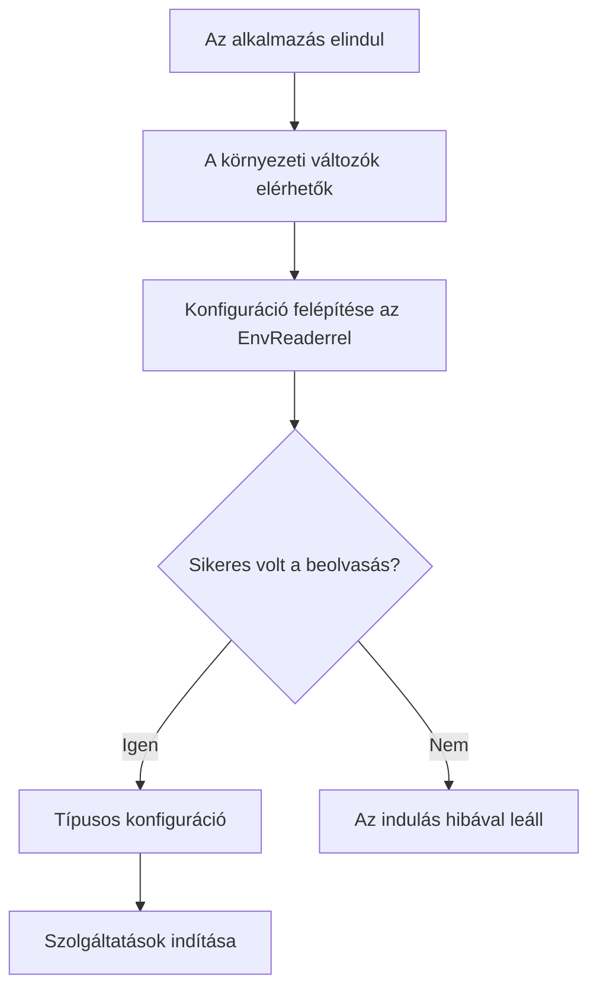
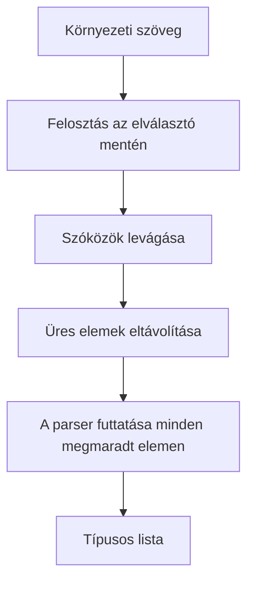
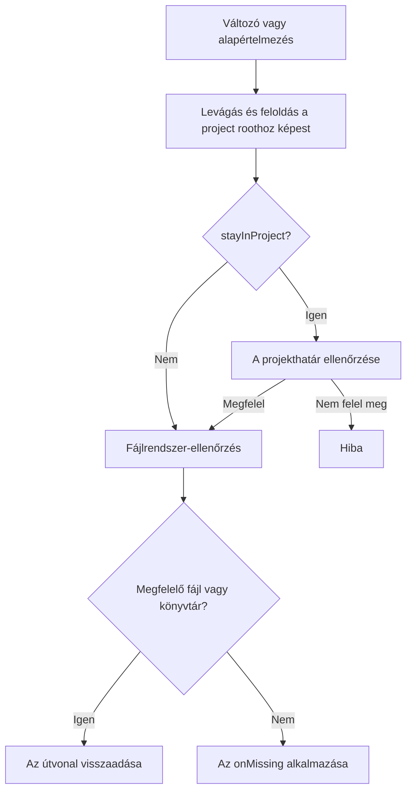

# @atom-forge/env-reader

> Ez az oldal a [docs/en/index.md](../en/index.md) magyar fordítása, amely az [Env Reader könyv](https://books.atom-forge.eu) egyoldalas változata.

Ez az útmutató bemutatja, hogyan olvasd be a környezeti konfigurációt TypeScript-alkalmazásokban: a telepítéstől a típusos konfigurációs objektumig, az URL-leképezéstől a fájlrendszerbeli útvonalakig.

Az `EnvReader` szinkron metódusokkal olvassa a `process.env` aktuális értékeit. A hibák akkor jelentkeznek, amikor ezeket a metódusokat meghívod, ezért ha induláskor akarsz validálni, a konfigurációt az alkalmazás indulásakor kell felépítened.

Az útmutató Node-kompatibilis TypeScript-alkalmazások (Node.js, Bun, Deno Node-kompatibilitással) fejlesztőinek szól, akik a konfigurációjukat egy helyen, típusosan és validálva szeretnék kezelni.

> **Tipp: Ajánlott olvasási sorrend**
>
> Kezdd az [Első lépések](#első-lépések) résszel, majd olvasd el a számodra szükséges adattípusokat. Az [Integráció és hibakezelés](#integráció-és-hibakezelés) egy teljes konfigurációs példát mutat. Korábbi verzióról frissítesz? Olvasd el a [Frissítés](#frissítés) részt. Kódoló ügynökkel dolgozol? Irányítsd a [README-AI.md](../../README-AI.md) fájlhoz.

## Mit kapsz?

- Kötelező és alapértelmezett értékkel rendelkező konfigurációs értékek.
- Szövegek, számok, logikai értékek, listák és reguláris kifejezések feldolgozása.
- URL-objektumok és típusos URL-komponens-leképezés.
- Fájl- és könyvtárútvonalak feloldása.
- Mélyen readonly TypeScript-típusok az `asReadonly` segítségével.

> **Megjegyzés: Futtatókörnyezet**
>
> A csomag a `process.env`-et és a Node-kompatibilis `fs` és `path` modulokat használja. Nem böngészőoldali konfigurációs könyvtár, és nem `.env`-betöltő.

## Első lépések

### Telepítés

```sh
npm install @atom-forge/env-reader
```

Importáld az `EnvReader` osztályt és szükség esetén az `asReadonly` függvényt a nyilvános belépési pontból.

```typescript
import { EnvReader, asReadonly } from "@atom-forge/env-reader";

const env = new EnvReader(process.cwd());

export const config = asReadonly({
    mode: env.oneOf("APP_ENV", ["dev", "prod", "test"], "prod"),
    databaseUrl: env.string("DATABASE_URL"),
    port: env.int("PORT", 3000),
});
```

A `process.cwd()` abszolút útvonal, de a folyamat munkakönyvtárát jelenti. Csak akkor használd project rootként, ha az alkalmazást tényleg onnan indítod; egyébként adj meg kifejezetten egy abszolút projektútvonalat.

### Hogyan zajlik az indulás?



> **Figyelem: A környezet betöltése a te feladatod**
>
> Az `EnvReader` nem olvas `.env` fájlokat. Ha ilyen fájlból töltöd be a környezetet, tedd meg a konfiguráció felépítése előtt, a futtatókörnyezettel vagy egy külön betöltővel.

### Kötelező érték vagy alapértelmezés?

Ha egy változó `undefined`, és nincs megadva alapértelmezés, a metódus hibát dob. Az alapértelmezés csak a hiányzó változót helyettesíti: a jelen lévő, de érvénytelen értéket nem javítja ki.

```typescript
const required = env.string("DATABASE_URL");
const optional = env.boolean("DEBUG", false);
```

> **Megjegyzés: Az üres nem ugyanaz, mint a hiányzó**
>
> A `KEY=""` jelen lévő változó, ezért az alapértelmezés nem érvényesül. A `string()` üres szöveget, a `list()` üres listát ad vissza; minden más metódus hibát dob. Ha nem üres szöveget vársz, azt külön ellenőrizd.

## Értékek és listák

### A metódusok áttekintése

| Hívás | Eredmény | Viselkedés |
|---|---|---|
| `string(key, defaultValue?, trim = true)` | `string` | Alapértelmezés szerint levágja a szélső szóközöket. |
| `int(key, defaultValue?, radix = 10)` | `number` | A teljes értéknek egész számnak kell lennie a megadott számrendszerben (2–36); 16-os számrendszernél `0x` előtag is megengedett. |
| `float(key, defaultValue?)` | `number` | A teljes értéknek véges tizedes számnak kell lennie, opcionálisan kitevővel. |
| `boolean(key, defaultValue?)` | `boolean` | `true/false`, `yes/no`, `1/0`; kis- és nagybetű nem számít. |
| `oneOf(key, values, defaultValue?)` | megengedett szövegtípus | Levágás után pontos, kis- és nagybetűérzékeny egyezést keres. A `values` lehet `as const` tömb is. |
| `regex(key, defaultValue?)` | `RegExp` | Levágás után a `new RegExp` konstruktort használja; üres mintát nem fogad el. |
| `list(key, parser, defaultValue?, separator = ",")` | `T[]` | Felosztás, levágás, üres elemek elhagyása, feldolgozás. |

```typescript
const name = env.string("APP_NAME", "My app");
const raw = env.string("RAW_TEXT", undefined, false);
const port = env.int("PORT", 3000);
const ratio = env.float("SAMPLING_RATIO", 0.5);
const debug = env.boolean("DEBUG", false);
const mode = env.oneOf("APP_ENV", ["dev", "prod", "test"], "prod");
const pattern = env.regex("NAME_PATTERN", /^[a-z]+$/i);
```

> **Figyelem: A számfeldolgozók a formátumot ellenőrzik, nem a tartományt**
>
> Az `int()` és a `float()` elutasítja a részleges egyezéseket, például a `"12px"`-et vagy (az `int()` esetén) az `"1.5"`-öt, valamint az `Infinity`-t, a `NaN`-t, a hexadecimális lebegőpontos számokat és a `Number.MAX_SAFE_INTEGER`-nél nagyobb egészeket. A minimumok, maximumok és egyéb szakmai tartományok ellenőrzése továbbra is a te feladatod.

> **Megjegyzés: Alapértelmezések**
>
> A string, number, boolean, oneOf, regex és list alapértelmezéseket a metódus közvetlenül, újabb feldolgozás nélkül adja vissza. Megbízható, előre validált értékeket adj meg.

### Listák

```typescript
// ALLOWED_HOSTS= example.com, api.example.com, ,
const hosts = env.list("ALLOWED_HOSTS", value => value);
// ["example.com", "api.example.com"]

const labels = env.list("LABELS", value => value, [], ";");
```



A parsernek hibát kell dobnia, ha érvénytelen elemet talál. A könyvtár a visszaadott `NaN`-t nem kezeli automatikusan hibaként.

```typescript
const ports = env.list("ALLOWED_PORTS", value => {
    if (!/^\d+$/.test(value)) throw new Error("Expected decimal digits");
    const port = Number(value);
    if (!Number.isSafeInteger(port) || port < 1 || port > 65535) {
        throw new Error("Port out of range");
    }
    return port;
});
```

> **Info: Érvénytelen listaelem**
>
> A parser hibájából `Env variable type failed: KEY[index] - value` hiba lesz. Az index nullától indul, és az üres elemek eltávolítása után számolódik; a parser eredeti hibaüzenete elvész.

### Reguláris kifejezések

A környezeti érték maga a minta, nem JavaScript regex-literál. A `^[a-z]+$` helyes; a `/^[a-z]+$/i` szöveg nem kapcsolja be az `i` flaget. A környezetből olvasott mintákhoz nincs külön flag-paraméter; egy alapértelmezett `RegExp` objektumnak lehetnek flagjei. Az üres (vagy csak szóközből álló) érték hibát dob, ahelyett hogy mindenre illeszkedő mintát adna.

## URL-ek és leképezések

### Az URL-objektum

```typescript
const api = env.url("API_URL", "https://api.example.com/v1/");
console.log(api.hostname); // A beállított URL hosztneve
```

A visszatérési érték szabványos `URL` objektum. A környezeti szöveget a konstruktornak átadás előtt levágja. Az alapértelmezett URL-t is feldolgozza és validálja; a hitelesítő adatok kiszivárgásának elkerülésére a hibaüzenet nem ismétli meg az érvénytelen alapértelmezést.

> **Figyelem: Az érvényes URL nem feltétlenül megengedett URL**
>
> A metódus nem korlátozza a protokollt HTTPS-re, és nem alkalmaz hoszt-engedélylistát. Ha erre szükséged van, a `protocol` és a `hostname` mezőt külön ellenőrizd.

### Típusos komponensleképezés

```typescript
// S3_URL=s3://accessKey:secretKey@storage.example.com/assets/files/
const storage = env.url("S3_URL", {
    map: {
        accessKey: "username",
        secretKey: "password",
        host: "hostname",
        bucket: "path(0)",
        prefix: ["path(1,end)", ""],
    },
});
// bucket: "assets", prefix: "files/"; minden mező szöveg
```

A második argumentum az opciós objektum: a `map` és egy opcionális `defaultValue`. A kimenet kulcsai megegyeznek a map kulcsaival; minden érték szöveg.

| Selector | Jelentés |
|---|---|
| `protocol` | Protokoll kettősponttal, például `https:`. |
| `username`, `password` | Percent-dekódolt hitelesítő komponensek. |
| `hostname` | Hosztnév port nélkül. |
| `host` | Hosztnév porttal, ha az URL-objektum megtartja. |
| `port` | Port szövegként; lehet üres. |
| `origin` | `${protocol}//${host}` formában összeállított szöveg. |
| `path` | Dekódolt útvonal a kezdő `/` nélkül. |
| `hash` | Fragmens a `#`-tel együtt, ha van. |
| `path(index)` | Egy dekódolt útvonalszegmens. |
| `path(start,end)` | Zárt szegmenstartomány; a záróindex lehet `end`. |
| `query("name")` | Az adott nevű első query-paraméter értéke; egyszeres idézőjellel is működik. |

Az URL-konstruktor normalizálhatja az értékeket, például eltávolíthatja az alapértelmezett portot. Az `origin`-t itt maga a csomag állítja össze, nem közvetlenül az `URL.origin` tulajdonságból veszi.

### Útvonalszegmensek

Az indexelés nullától indul; a negatív index a végétől számol. Az indexelt selectorok a felosztáskor elhagyják az üres szegmenseket.

A `/assets/images/logo.svg` útvonalra:

- `path(0)` → `assets`
- `path(-1)` → `logo.svg`
- `path(1,end)` → `images/logo.svg`

Ha egy tartomány az utolsó szegmensig ér, megtartja az URL záró `/` jelét, ha volt ilyen. Egyetlen szegmens kiválasztása nem teszi hozzá.

### Fallbackek pontosan

```typescript
const endpoint = env.url("SERVICE_URL", {
    defaultValue: "https://api.example.com/v1/",
    map: {
        host: "hostname",
        token: ['query("token")', ""],
        extraPath: ["path(2,end)", ""],
    },
});
```

> **Figyelem: Nem minden üres komponens vált ki fallbacket**
>
> A fallback csak hiányzó query-paraméterre és tartományon kívüli útvonalszegmensre vonatkozik. A hiányzó `username`, `password`, `port` vagy `hash` fallback nélkül is üres szövegként jön vissza. A `?token=` szintén üres szöveget ad, nem az alapértelmezést.

Az érvénytelen selectort és a hibás percent-kódolást a fallback nem nyeli el. A leképezési hibák `Env variable URL map failed: KEY - ...` előtagot kapnak; a hibás escape-szekvenciát a csomag `Malformed percent-encoding in URL component: <selector>` üzenettel jelzi, a nyers érték nélkül.

## Fájlok és könyvtárak

```typescript
const certificate = env.file("TLS_CERT", "certs/server.pem");
const uploads = env.dir("UPLOAD_DIR", "var/uploads");
```

Mindkét metódus abszolút útvonalat ad vissza, és szinkron fájlrendszer-ellenőrzést végez.

```typescript
file(key, defaultValue?, onMissing = true, stayInProject = true)
dir(key, defaultValue?, onMissing = true, stayInProject = true)
```

### Feloldás

Az értéket levágja, és `path.resolve(projectRoot, value)` segítségével oldja fel, a `stayInProject` értékétől függetlenül: a relatív útvonal mindig a project roothoz képest értendő, az abszolút útvonal változatlan marad. Az üres érték hibát dob. Magát a project rootot a konstruktor `path.resolve`-val normalizálja.

- `stayInProject = true`: a feloldott útvonalnak a project rooton belül kell lennie, lexikálisan és a symlinkek feloldása után is.
- `stayInProject = false`: nincs határellenőrzés; külső abszolút vagy `../` útvonalak is megengedettek.



### Hiányzó vagy rossz típusú útvonalak

| `onMissing` | Viselkedés |
|---|---|
| `true` | Hibát dob; ez az alapértelmezés. |
| `false` | Visszaadja az útvonalat, semmit nem hoz létre. |
| `(path) => void` | Meghívja a callbacket, majd visszaadja az útvonalat, ha a callback nem dobott hibát. |

A callback hiányzó útvonalnál és rossz típusnál is lefuthat: például ha a `dir()` egy fájlt talál ott, ahol könyvtárat keres. A callback után nincs újabb típusellenőrzés.

```typescript
import * as fs from "node:fs";

const cache = env.dir("CACHE_DIR", "var/cache", directory => {
    fs.mkdirSync(directory, { recursive: true });
});
```

> **Megjegyzés: A hiányzó változó továbbra is hiba**
>
> Az `onMissing = false` csak a fájlrendszer-ellenőrzés eredményét kezeli. Ha a környezeti változó és az alapértelmezés is hiányzik, a metódus hibát dob.

> **Figyelem: Induláskori ellenőrzés, nem sandbox**
>
> A projekthatárt útvonalszegmensenként hasonlítja össze, így egy testvérkönyvtár, például a `/app-evil` nincs a `/app`-on belül. A symlinkeket is feloldja, a még nem létező útvonal szülőkönyvtárában lévőket is. Az ellenőrzés egyszer fut le, a metódus hívásakor: ha a fájlrendszer később megváltozik (például egy könyvtárat symlinkre cserélnek), a visszaadott útvonalat nem validálja újra. Ne tekintsd elszigetelésnek olyan nem megbízható bemenetnél, amelyet sokkal később nyitsz meg.

## Integráció és hibakezelés

### Egyetlen konfigurációs modul

Az alkalmazás többi része egy előre felépített konfigurációt használjon, ne ismételje a környezet beolvasását.

```text
src/
  config.ts       # Környezeti értékek beolvasása és validálása
  server.ts       # A konfiguráció használata
```

```typescript
// config.ts
import { EnvReader, asReadonly } from "@atom-forge/env-reader";

const env = new EnvReader(process.cwd());
const port = env.int("PORT", 3000);
if (!Number.isInteger(port) || port < 1 || port > 65535) {
    throw new Error("PORT must be an integer between 1 and 65535");
}

export const config = asReadonly({
    app: {
        mode: env.oneOf("APP_ENV", ["dev", "prod", "test"], "prod"),
        port,
        debug: env.boolean("DEBUG", false),
    },
    database: {
        url: env.url("DATABASE_URL"),
        poolSize: env.int("DB_POOL_MAX", 20),
    },
    auth: {
        secret: env.string("JWT_SECRET"),
    },
});

if (!config.auth.secret) {
    throw new Error("JWT_SECRET must not be empty");
}
```

> **Tipp: A szakmai szabályokat te határozod meg**
>
> A minimális poolméret, a titok minimális hossza, a megengedett URL-protokoll és a mezők közötti összefüggések külön, alkalmazásszintű ellenőrzést igényelnek. A könyvtár nem konfigurációs séma és nem üzleti validátor.

### Mit jelent az asReadonly?

```typescript
const config = asReadonly({ db: { host: "localhost" } });
// config.db.host = "other"; // TypeScript fordítási hiba
```

Az `asReadonly<T>(value: T): DeepReadonly<T>` ugyanazt az objektumot adja vissza, típus-asszercióval. Nem készít másolatot, és nem hívja meg az `Object.freeze`-t. A függvények, valamint az `URL`, `RegExp`, `Date` és `Error` értékek megtartják a saját típusukat, így hívhatók és használhatók maradnak; a tömbök, Map-ek és Set-ek readonly változatot kapnak.

> **Figyelem: Csak típusszintű védelem**
>
> JavaScriptből vagy egy másik, módosítható referencián keresztül az objektum továbbra is módosítható. A readonly típus nem futásidejű megváltoztathatatlanság és nem biztonsági határ.

### Hibakezelés és naplózás

A metódusok szinkron `Error`-t dobnak. Nincs olyan hibajelentés, amely a teljes konfigurációt összegyűjtené: az első dobott hiba megszakítja a konfiguráció felépítését.

| Helyzet | Példaüzenet |
|---|---|
| Hiányzó érték | `Missing Env variable (string): DATABASE_URL` |
| Érvénytelen érték | `Env variable type failed: PORT (int)` |
| Érvénytelen listaelem | `Env variable type failed: ALLOWED_PORTS[0] - invalid` |
| URL-leképezési hiba | `Env variable URL map failed: SERVICE_URL - ...` |
| Nem fájl | `Env variable path is not a file: TLS_CERT - ...` |

> **Veszély: Titkok a hibaüzenetekben**
>
> Egyes üzenetek listaelemet vagy abszolút fájlrendszerbeli útvonalat tartalmaznak. Naplózás előtt gondolj a kitakarásra; ne naplózd a teljes konfigurációs objektumot vagy a `process.env` tartalmát.

### Integrációs ellenőrzőlista

- [ ] A környezet betöltése a konfiguráció felépítése előtt történik.
- [ ] A project root abszolút, és helyes, bárhonnan is indítod az alkalmazást.
- [ ] A kötelező titkoknak nincs kényelmi alapértelmezése.
- [ ] Ahol kell, külön ellenőrzöd az üres szövegeket.
- [ ] Validálod a számtartományokat és az URL-ek szakmai szabályait.
- [ ] A szolgáltatások csak a konfiguráció validálása után indulnak.
- [ ] A tesztekben visszaállítod a módosított környezeti változókat, és eltakarítod az ideiglenes fájlokat.

> **Megjegyzés: Ismételt olvasás**
>
> Az `EnvReader` nem készít pillanatképet a környezetről. Minden metódushívás az aktuális `process.env`-et olvassa. A fent egyszer felépített konfiguráció viszont nem frissül automatikusan, ha a környezet később megváltozik.

## Frissítés

Ez a rész azokat a változásokat gyűjti össze, amelyek frissítéskor teendőt igényelhetnek. Minden alfejezet egy verziólépést fed le; olvasd el az összeset a jelenlegi és a célverziód között. A változások teljes listája, a teendőt nem igénylőkkel együtt, a [changelogban](../../CHANGELOG.md) található.

### 0.1.6-ról 0.2.0-ra

```sh
npm install @atom-forge/env-reader@latest
```

A változások többsége szigorúbbá teszi a validálást. Egy korábban elfogadott konfiguráció most hibával leállíthatja az indulást: ez szándékos, mert a régi eredmény többnyire hibás volt. Indítsd el az alkalmazást minden környezetben, ahová telepítesz (fejlesztői, CI, staging, éles), és javítsd a jelzett változókat.

#### A számoknak teljesnek kell lenniük

Az `int()` és a `float()` korábban mindent elfogadott, aminek az elejét a `parseInt` vagy a `parseFloat` be tudta olvasni. Most a teljes értéknek számnak kell lennie.

| Érték | 0.1.x | Új |
|---|---|---|
| `int`: `"12px"` | `12` | hiba |
| `int`: `"1.5"` | `1` | hiba |
| `int`: `"1e3"` | `1` | hiba |
| `int`: `"99999999999999999999"` | pontatlan szám | hiba |
| `float`: `"Infinity"`, `"1e999"` | `Infinity` | hiba |
| `float`: `"1,5"` | `1` | hiba |
| `float`: `"0x10"` | `0` | hiba |

Az `int()` 16-os számrendszerben továbbra is elfogadja a `0x` előtagot. A 2–36 tartományon kívüli számrendszer már a metódus hívásakor hibát dob.

**Teendő:** javítsd a környezeti értékeket úgy, hogy csak a számot tartalmazzák (például `PORT=3000`, nem `PORT=3000/tcp`). Ha szándékosan támaszkodtál a megengedő feldolgozásra, olvasd be az értéket `string()`-gel, és dolgozd fel magad.

#### Több metódus utasítja el az üres értéket

A `KEY=""` (vagy csak szóközből álló érték) mostantól hibát dob a `regex()`, a `file()` és a `dir()` metódusban.

| Metódus | 0.1.x eredménye üres értékre | Új |
|---|---|---|
| `regex()` | `/(?:)/`, amely minden szövegre illeszkedik | hiba |
| `dir()` | a project root | hiba |
| `file()` | hiba (a project root nem fájl) | hiba, egyértelműbb üzenettel |

Az alapértelmezés továbbra is csak hiányzó változóra érvényes, üresre nem.

**Teendő:** töröld az üres értékadásokat a környezeti fájlokból, hogy az alapértelmezés érvényesüljön, vagy adj meg valódi értéket.

#### `stayInProject = false` mellett a relatív útvonal a project roothoz képest oldódik fel

A 0.1.x-ben a `file()` és a `dir()` a relatív útvonalat `stayInProject = false` esetén a **folyamat munkakönyvtárához**, egyébként a project roothoz képest oldotta fel. Most a relatív útvonal mindig a project roothoz képest értendő; a `stayInProject = false` csak a határellenőrzést kapcsolja ki.

```typescript
const env = new EnvReader("/srv/app");
// LOG_DIR=../logs, a folyamat a /srv/app/dist könyvtárban indult

env.dir("LOG_DIR", undefined, true, false);
// 0.1.x: /srv/app/logs   (a munkakönyvtárhoz képest)
// Új:    /srv/logs       (a project roothoz képest)
```

**Teendő:** keresd meg a kódodban azokat a hívásokat, amelyek negyedik argumentumként `false`-t adnak át. Ha a hozzájuk tartozó környezeti értékek relatívak, írd át őket a project roothoz képest, vagy használj abszolút útvonalat, amely ugyanúgy viselkedik, mint korábban.

#### Szigorúbb a projekthatár

Az alapértelmezett `stayInProject = true` mellett a határellenőrzés korábban egyszerű szöveges prefixvizsgálat volt. Most útvonalszegmenseket hasonlít össze, és feloldja a symlinkeket.

- Az azonos prefixű testvérkönyvtárat (`/srv/app-data` a `/srv/app` roothoz) már nem fogadja el.
- A projekten belüli, kifelé mutató symlinket elutasítja, akkor is, ha a célfájl még nem létezik.

**Teendő:** ha egy útvonal jogosan van a projekten kívül, például egy csatolt kötet vagy egy symlinkelt megosztott könyvtár, add át a `stayInProject = false` értéket az adott hívásnál.

#### Hibaüzenetek

- Az érvénytelen alapértelmezett URL már nem szerepel az üzenetben, így a benne lévő hitelesítő adatok nem kerülnek a naplókba: `Env variable default is not a valid url: KEY`.
- Az URL-leképezésben lévő hibás percent-kódolás üzenete `URI error` helyett `Malformed percent-encoding in URL component: <selector>`.
- Az üres értéket `Env variable type failed: KEY (regex) - empty pattern` vagy `... (dir) - empty path` üzenet jelzi.

**Teendő:** csak akkor releváns, ha a kódod vagy a monitorozásod az üzenet szövegére illeszt. Inkább a változó nevére illessz.

#### TypeScript-típusok

- Az `asReadonly()` változatlanul hagyja a függvényeket és az `URL`, `RegExp`, `Date` és `Error` értékeket. A konfigurációban lévő függvények most már hívhatók (a 0.1.x-ben elvesztették a hívási szignatúrájukat); egy `URL` mező típusa most `URL`, nem a tulajdonságainak readonly másolata.
- A tömbök, a `Map` és a `Set` értékek `readonly` tömbbé, `ReadonlyMap`-pé és `ReadonlySet`-té válnak. Az a kód, amely módosító metódust hívott rajtuk (például `push`), már nem fordul le; ez mindig is hiba volt, hiszen az objektum csak olvasásra való.

**Teendő:** futtasd a típusellenőrzőt, és javítsd a readonly konfiguráció általa jelzett módosításait.

#### Csomag és futtatókörnyezet

- A csomag az `engines` mezőben `node >= 18`-at deklarál.
- A csomag csak npm-en jelenik meg; a JSR-es verzió 0.1.1-en marad, és nem frissül.

**Teendő:** ha régebbi Node.js-t futtatsz, frissítsd 18-ra vagy újabbra. Ha a csomagot JSR-ről telepítetted, válts az npm-csomagra.
